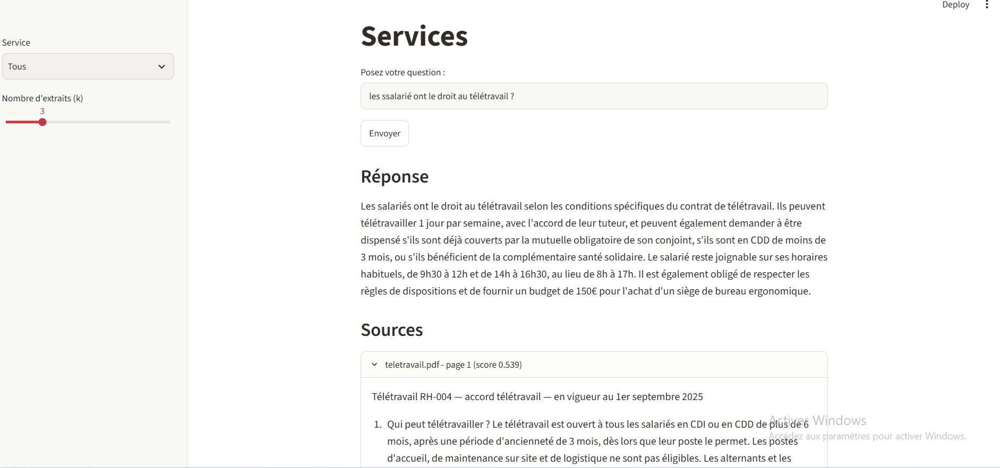

# Assistant RAG - Altéa Services

Prototype d'assistant documentaire : un salarié pose une question en français et obtient une réponse rédigée **à partir des documents internes d'Altéa Services**, avec **la source citée** (fichier, page).



## 1. Objectif

Construire pas à pas un RAG (*Retrieval-Augmented Generation*) : les documents sont préparés et indexés une fois, puis interrogés à chaque question. Le LLM ne répond qu'à partir des extraits retrouvés, ce qui limite les hallucinations.

Corpus : 15 documents fictifs (8 PDF, 7 textes), 23 pages, répartis en 3 services : RH (5), IT (5), Général (5).

## 2. Les 8 étapes

| N° | Étape | Fichier | Rôle |
|---|---|---|---|
| 1 | Collecte | `etape1_collecte.py` | Lit les PDF (pypdf) et les `.txt`, garde pour chaque page : texte, fichier, page, service |
| 2 | Nettoyage | `etape2_nettoyage.py` | Retire espaces multiples, lignes vides, mots coupés, numéros de page, en-têtes et pieds de page répétés |
| 3 | Découpage | `etape3_decoupage.py` | Chunks de 500 caractères, chevauchement 50 |
| 4 | Embeddings + indexation | `etape4_indexation.py` | Vecteurs (384 dimensions) rangés dans ChromaDB avec `upsert` |
| 5 | Recherche | `etape5_recherche.py` | Retrouve les k chunks les plus proches, filtre possible par service |
| 6 | Génération | `etape6_generation.py` | Construit le prompt et fait rédiger la réponse sourcée par le LLM |
| 7 | Évaluation | `etape7_evaluation.py` | Mesure la recherche et les réponses sur 10 questions (`evaluation.csv`) |
| 8 | Mise à disposition | `app.py` | Interface web Streamlit |

## 3. Installation

Prérequis : Python 3.10 ou plus (testé avec 3.12), Git.

```bash
git clone https://github.com/Ishak-devs/module_rag.git
cd module_rag
python -m pip install -r requirements.txt
```

Placer les documents dans `docs/RH/`, `docs/IT/` et `docs/General/` (le service est déduit du nom du dossier). La base `base_vectorielle/` n'est **pas** versionnée : elle est recréée par l'étape 4.

## 4. Ordre de lancement

```bash
python etape1_collecte.py          # nombre de pages par document
python etape2_nettoyage.py         # texte avant / après nettoyage
python etape3_decoupage.py         # tableau des tailles de chunks
python etape4_indexation.py        # embeddings + création de la base
python etape5_recherche.py         # test de la recherche
python etape6_generation.py        # prompt + réponses du LLM
python etape7_evaluation.py recherche   # taux de réussite de la recherche
python etape7_evaluation.py generer     # génère resultats.csv
# noter à la main resultats.csv (colonnes 5 et 6), puis :
python etape7_evaluation.py bilan
streamlit run app.py               # interface web
```

Sous Windows, `lancer_tout.bat` enchaîne les étapes 1 à 7 (sorties dans `sorties.txt`).

**LLM :** `etape6_generation.py` utilise le modèle `Qwen/Qwen2.5-0.5B-Instruct` via `transformers` (téléchargé au premier lancement, environ 1 Go). Le décodage est glouton (`do_sample=False`), équivalent de `temperature=0`. La variable `SANS_LLM = True` désactive le modèle et affiche seulement le passage le plus proche.

## 5. Exemple de question

> **Question :** Combien de jours de télétravail par semaine sont autorisés chez Altéa ?
> **Réponse :** chaque salarié éligible peut télétravailler jusqu'à 2 jours par semaine (source : `teletravail.pdf`, page 1).
> **Précision du document :** le mardi est un jour de présence obligatoire, aucun télétravail n'est possible ce jour-là.

Sans extraits (LLM seul), le modèle répond qu'il n'a pas l'information : il ne connaît pas Altéa. Avec le RAG, la réponse vient du bon document.

## 6. Résultats

### Étapes 1 à 5 (mesurés)

- **Collecte :** 15 documents, 23 pages, aucune page vide après nettoyage.
- **Découpage :**

| Taille | Chevauchement | Chunks | Longueur moyenne |
|---|---|---|---|
| 200 | 20 | 148 | 187 |
| **500** | **50** | **62** | **437** |
| 1000 | 100 | 37 | 717 |

  Taille retenue : **500 / 50**, compromis entre le contexte conservé (assez long pour garder une règle et sa condition) et la précision de l'embedding.
- **Indexation :** modèle `paraphrase-multilingual-MiniLM-L12-v2`, vecteurs de dimension 384. 62 chunks produits, 62 indexés, soit 62 × 384 = 23 808 nombres stockés. Une réindexation ne crée pas de doublons (`upsert`, identifiants `fichier_page_chunk`).
- **Similarité :** « poser des jours de congé » et « demander des vacances » : 0,53 (sens proche malgré peu de mots communs) ; « mot de passe oublié » et « réinitialiser mon accès » : 0,36 ; phrases de sujets différents : 0,06 à 0,19.
- **Recherche (k = 3) :** le bon document est classé premier pour les 3 questions de test : télétravail (`teletravail.pdf`, score 0,70), VPN (`vpn.txt`, 0,74), frais de déplacement (`notes_de_frais.pdf`, 0,63).

### Étape 7 (évaluation sur 10 questions)

| Mesure | Résultat |
|---|---|
| Recherche : bon document dans les 3 premiers chunks | **X / 10** |
| Réponses justes | **X %** |
| Réponses correctement sourcées | **X %** |

> Remplacer les X par les valeurs de `python etape7_evaluation.py recherche` et `bilan`.

## 7. Limites connues

- **Tableaux :** l'extraction aplatit les tableaux (ex. plafonds de `notes_de_frais.pdf`, une cellule par ligne), ce qui sépare un libellé de son montant.
- **Génération :** avec un petit modèle, la réponse peut omettre une exception présente dans l'extrait (ex. « jamais le mardi ») ou citer « l'extrait 1 » au lieu du nom du fichier.
- **Modèle léger :** le LLM de 0,5 milliard de paramètres, choisi pour tourner sur un PC sans GPU, est moins fiable qu'un grand modèle.
- **Ollama :** sur la machine de développement (Windows), Ollama plantait (`llama-server`, code 0xc0000409). Le LLM est donc lancé directement avec `transformers`.
- **Pas de gestion des droits :** le filtre par service est choisi dans l'interface, il ne remplace pas une authentification.
- **Pas de mise à jour automatique :** un document modifié doit être réindexé (supprimer ses anciens chunks puis relancer l'étape 4).
- **Jeu d'évaluation réduit :** 10 questions, insuffisant pour une conclusion statistique.

## 8. Pistes avant déploiement

Droits d'accès par salarié, protection des données personnelles (RGPD), mise à jour des documents, coût et hébergement du LLM (détails dans `reponses.md`, Q14).

## 9. Fichiers du dépôt

- `reponses.md` : réponses écrites aux questions du TP
- `evaluation.csv` : 10 questions et document attendu
- `requirements.txt`, `.gitignore`, `lancer_tout.bat`

## 10. Auteurs

Ishak (GitHub : Ishak-devs) - compléter avec les noms et prénoms.
