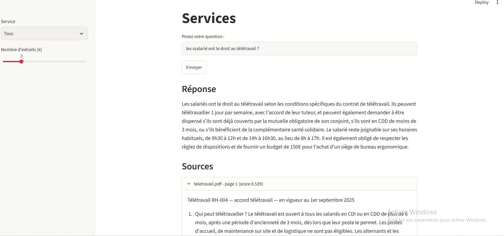

# Assistant RAG - Altéa Services

## Objectif
Prototype d'assistant qui répond aux questions des salariés à partir de la documentation interne (RH, IT, Général) et **cite toujours le document et la page** d'où vient la réponse.

## Installation
```bash
python -m venv .venv && source .venv/bin/activate
pip install -r requirements.txt
ollama pull llama3.2       # LLM local
```
Placer les documents dans `docs/RH/`, `docs/IT/`, `docs/General/`.

## Ordre de lancement
```bash
python etape1_collecte.py     # lecture et comptage des pages
python etape2_nettoyage.py    # avant/après nettoyage
python etape3_decoupage.py    # tableau des tailles de chunks
python etape4_indexation.py   # embeddings + base vectorielle
python etape5_recherche.py    # test de la recherche
python etape6_generation.py   # test des réponses
python etape7_evaluation.py recherche   # taux de réussite de la recherche
python etape7_evaluation.py generer     # génère resultats.csv à noter à la main
python etape7_evaluation.py bilan
streamlit run app.py          # interface web
```

## Exemple
> **Q :** Combien de jours de télétravail par semaine ?
> **R :** (réponse + source : `teletravail.pdf`, p. X)
>


## Résultats (étape 7)
- Réussite de la recherche : **À REMPLIR** / 10
- Réponses justes : **À REMPLIR** % - correctement sourcées : **À REMPLIR** %

## Limites connues
- Pas d'authentification ni de droits d'accès fins (simple filtre par service).
- Tableaux et mises en page complexes des PDF parfois mal extraits.
- Qualité dépendante du LLM local et de la taille des chunks (500 / 50).
- Pas de mise à jour automatique des documents modifiés.

## Auteurs
À REMPLIR
